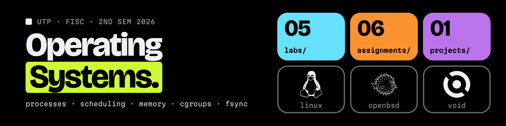

<picture>
  <source media="(prefers-color-scheme: light)" srcset="assets/banner-light.png">
  
</picture>

# Operating Systems, UTP 2026

Labs, assignments and a group project from the Operating Systems course (Sistemas Operativos, group 1IL143) at Universidad Tecnológica de Panamá, taught by Prof. Isacio Tamayo. Most of the work is incident-style: a service misbehaves, and the job is to find the cause with kernel tools, fix it at the OS or container level, and prove the fix with measurements.

Each folder has an English README with the task, the result and what I took from it. The submitted reports are in Spanish. Course guides and starter files live in the professor's repository, [isacioutp/Sistema-Operativo-utp](https://github.com/isacioutp/Sistema-Operativo-utp).

## Highlights

| Finding | Where |
| --- | --- |
| A service answered `200` in 26 to 438 s because its container thrashed in swap. Someone had read `--memory-swap` as the swap size, when it is the total. After resizing, latency was about 0.1 s. | [Lab 4](labs/04-thrashing-swap) |
| After a hard crash, a file written without `fsync` came back with 0 bytes and the one written with `fsync` was complete. ext4 recovered cleanly both times, because the journal protects metadata, not data nobody asked to persist. | [Lab 5](labs/05-fds-durability) |
| With 20 CPU hogs at a higher priority in the same container, a login took 105.9 s. Swapping only the two `nice` values brought it back to 2.5 s. CFS weights predicted 10.5 s for the equal-priority case, and I measured 10.2 s. | [Assignment 2b](assignments/02b-docker-cpu-priority) |
| A container died with `Exited (137)`. `dmesg`, `docker inspect`, `docker events` and the cgroup files all point to a memory leak against a 256 MB limit. Detection to fix took 13 minutes. | [Assignment 3](assignments/03-oom-killer-incident) |
| I calculated Nginx and MySQL sizing by hand, then checked it on a VM resized to each scenario. The native install served 52 337 req/s and the Docker route 27 938, with 0 OOM events. | [Case study](assignments/06-case-study-nginx-mysql) |
| An Envoy connection cap of 150 held under 200 connections. Cassandra reached 6 985 op/s, 14 % of the target. The report says so instead of claiming a capacity it did not reach. | [Project 1](projects/01-envoy-cassandra) |

## Contents

### Labs

| # | Topic | Main tools |
| --- | --- | --- |
| [01](labs/01-linux-environment) | Deploying the course VM: Terraform fails on VirtualBox 7, so Vagrant is used | VirtualBox, Terraform, Vagrant |
| [02](labs/02-processes-signals-proc) | Processes, POSIX signals and the `/proc` interface | `ps`, `pstree`, `kill`, `trap`, `strace` |
| [03](labs/03-cpu-scheduling) | Real scheduling in Linux, and a scheduler simulator with a fixed SJF | `nice`, `renice`, `chrt`, `taskset`, Python |
| [04](labs/04-thrashing-swap) | Incident: a service that answers 200 but crawls because of swap thrashing | `vmstat`, cgroups v2, `docker update` |
| [05](labs/05-fds-durability) | Nginx 502 from `EMFILE`, and MySQL losing "committed" data without `fsync` | `/proc/<pid>/fd`, `strace`, `fsync` |

### Assignments

| # | Topic | Main tools |
| --- | --- | --- |
| [01](assignments/01-os-identification) | Identifying and classifying Windows and Linux from the running system | `systeminfo`, `tasklist`, `uname`, `ps` |
| [02a](assignments/02a-os-structures) | Monolithic, layered, microkernel, VM and client/server designs | Research |
| [02b](assignments/02b-docker-cpu-priority) | Giving a Flask service CPU priority inside a limited container | Docker, Compose, `nice`, `htop` |
| [03](assignments/03-oom-killer-incident) | Incident response and RCA for a container killed by the OOM killer | Docker, cgroups v2, `dmesg` |
| [05](assignments/05-redis-kernel) | Redis seen from the kernel: page cache, inodes, descriptors, `appendfsync` | `/proc`, `posix_fadvise`, `redis-cli` |
| [06](assignments/06-case-study-nginx-mysql) | Case study: sizing Nginx and MySQL on two servers, native against Docker | Nginx, MySQL 5.7, Docker, `ab` |

The course numbers two assignments as 2, so they are 02a and 02b here.

### Projects

| # | Topic | Main tools |
| --- | --- | --- |
| [01](projects/01-envoy-cassandra) | Group project: Envoy and Cassandra 5 on 6 GB and 3 vCPU, with a live stress test | Docker, cgroups v2, `cassandra-stress` |

## Topics covered

| Topic | Labs and assignments |
| --- | --- |
| Processes, signals, `/proc` | Lab 2, Assignment 1 |
| CPU scheduling, CFS weights, `nice`, real-time policies | Lab 3, Assignment 2b |
| Memory, swap, thrashing, OOM killer | Lab 4, Assignment 3, Project 1 |
| cgroups v2 limits for memory, swap and CPU | Lab 4, Assignment 3, Case study, Project 1 |
| File descriptors, page cache, `fsync`, inodes | Lab 5, Assignment 5 |
| OS structures and virtualization | Lab 1, Assignment 2a |
| Capacity planning | Case study, Project 1 |

## Environment

Almost everything ran on the course VM built in Lab 1: an Ubuntu 18.04.6 guest (kernel 4.15) with 2 vCPUs and 2 GB of RAM on VirtualBox 7.2, on a Windows 11 laptop. Docker 24.0.2 and Compose 2.18.1 were added later for the container work. The case study and Project 1 resized the same VM with `VBoxManage` for each scenario (8 GB and 4 vCPU, 4 GB and 2 vCPU, 6 GB and 3 vCPU).

Hyper-V is active on the host, so VirtualBox falls back to NEM mode (`AMD-V is not available`). Because of this the VM sometimes crawled or hung at boot, and each report notes where it got in the way. Lab 2 is the exception: the VM would not boot that week, so I ran it on Ubuntu under WSL2.

## Layout

```text
.
├── labs/
│   └── NN-topic/
│       ├── README.md       summary in English
│       ├── report.pdf      submitted report (Spanish)
│       ├── src/            code, scripts and configs
│       └── screenshots/    terminal captures used as evidence
├── assignments/            same structure
├── projects/               same structure, plus figures/ and a demo video
└── assets/                 banner (PNG for each GitHub theme, and its HTML source)
```

Files provided by the course, such as `app.py` in the incident labs, are kept unmodified, and each README says which files they are. Personal ID numbers were removed from the report cover pages before publishing.

## Credits

Course material by Prof. Isacio Tamayo. Project 1 is group work (Group 2). The banner uses my Ring Zero design system. The Linux, OpenBSD and Void Linux logos come from [Simple Icons](https://simpleicons.org) (CC0), and the trademarks belong to their owners.
