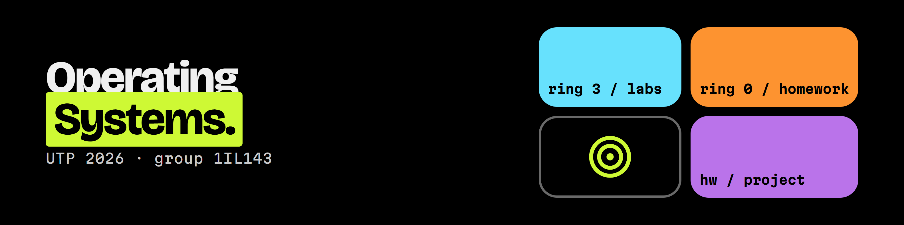

# Operating Systems (UTP, 2nd semester 2026)

Labs, homework, a group project and a class presentation from the Operating Systems course (Sistemas Operativos, group 1IL143) at Universidad Tecnológica de Panamá, taught by Prof. Isacio Tamayo. The course guides and starter files live in the professor's repository, [isacioutp/Sistema-Operativo-utp](https://github.com/isacioutp/Sistema-Operativo-utp).

Each folder has a README in English that explains the task and what came out of it. The reports themselves are in Spanish, because that is how they were submitted.

## Contents

| Folder | Topic | Main tools |
| --- | --- | --- |
| [labs/lab1-linux-environment](labs/lab1-linux-environment) | Deploying the course VM with Terraform and Vagrant | VirtualBox, Terraform, Vagrant |
| [labs/lab2-processes-signals-proc](labs/lab2-processes-signals-proc) | Processes, POSIX signals and the `/proc` interface | `ps`, `pstree`, `kill`, `trap`, `strace` |
| [labs/lab3-cpu-scheduling](labs/lab3-cpu-scheduling) | Real scheduling in Linux (3A) and a scheduler simulator (3B) | `nice`, `renice`, `chrt`, `taskset`, Python |
| [labs/lab4-thrashing-swap](labs/lab4-thrashing-swap) | Incident drill: a service that answers 200 but crawls because of swap thrashing | `vmstat`, cgroups v2, `docker update` |
| [labs/lab5-fds-durability](labs/lab5-fds-durability) | Nginx 502 from `EMFILE`, and MySQL losing "committed" data without `fsync` | `/proc/<pid>/fd`, `strace`, `fsync` |
| [assignments/tarea1-os-identification](assignments/tarea1-os-identification) | Identifying and classifying Windows and Linux | `systeminfo`, `tasklist`, `uname`, `ps` |
| [assignments/tarea2-os-structures](assignments/tarea2-os-structures) | Monolithic, layered, microkernel, VM and client/server designs | Research |
| [assignments/tarea2-docker-cpu-priority](assignments/tarea2-docker-cpu-priority) | Giving a Flask service CPU priority inside a limited container | Docker, Compose, `nice`, `htop` |
| [assignments/tarea3-oom-killer-incident](assignments/tarea3-oom-killer-incident) | Incident response and RCA for a container killed by the OOM killer | Docker, cgroups v2, `dmesg` |
| [assignments/tarea5-redis-kernel](assignments/tarea5-redis-kernel) | Redis seen from the kernel: page cache, inodes, descriptors, `appendfsync` | `/proc`, `posix_fadvise`, `redis-cli` |
| [assignments/caso-estudio-nginx-mysql](assignments/caso-estudio-nginx-mysql) | Sizing Nginx and MySQL on two servers, native against Docker | Nginx, MySQL 5.7, Docker, `ab` |
| [projects/proyecto1-envoy-cassandra](projects/proyecto1-envoy-cassandra) | Group project: Envoy and Cassandra 5 on 6 GB and 3 vCPU, with a live stress test | Docker, cgroups v2, `cassandra-stress` |
| [presentations](presentations) | Class presentation on the Linux OOM killer | |

The course has two assignments numbered 2. Both are here, one per folder.

## Environment

Almost everything ran on the course VM built in Lab 1, an Ubuntu 18.04.6 guest (kernel 4.15) with 2 vCPUs and 2 GB of RAM on VirtualBox 7.2, hosted on a Windows 11 laptop. Docker 24.0.2 and Compose 2.18.1 were added later for the container assignments. One problem kept coming back. Hyper-V is active on the host, so VirtualBox falls back to its NEM mode (`AMD-V is not available`) and the VM would sometimes crawl or hang at boot, which each report mentions where it got in the way.

The case study and Project 1 resized that same VM with `VBoxManage` to match each scenario (8 GB and 4 vCPU, 4 GB and 2 vCPU, 6 GB and 3 vCPU).

However, Lab 2 is the exception. The VM would not boot that week, so the lab was done on Ubuntu under WSL2.

## Layout

Every lab, assignment or project folder follows roughly the same pattern.

- `README.md` with a summary in English
- `report.pdf`, the submitted report in Spanish
- `screenshots/` with the terminal captures used as evidence
- `src/` or loose files for the code, scripts and configs

Personal ID numbers were removed from the report cover pages before publishing.
