# Reporte de Entrega - Laboratorio 1: Preparación del Entorno Linux

* **Estudiante:** James Tack
* **Curso:** Sistemas Operativos
* **Grupo:** 1IL143
* **Fecha:** 03/09/2026
* **Método Utilizado:** Terraform (intentado) y Vagrant (el que completó el despliegue)
* **Enlace al Repositorio:** https://github.com/isacioutp/Sistema-Operativo-utp (carpeta `lab1-preparacion-entorno`)

---

## Herramientas del anfitrión

El anfitrión es un Dell Inspiron 16 5645 con Windows 11 Pro. VirtualBox ya estaba instalado; Vagrant y
Terraform los agregué con `winget`.

```text
PS C:\Users\Lost\laboratorio-1> VBoxManage --version; vagrant --version; terraform --version
7.2.16r174877
Vagrant 2.4.9
Terraform v1.15.8
on windows_amd64
+ provider registry.terraform.io/terra-farm/virtualbox v0.2.2-alpha.1
```

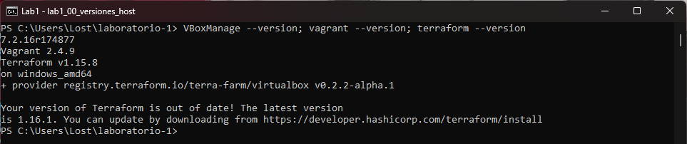

---

## Parte 1: Confirmación del Plan y Despliegue de IaC

### 1.1 Opción A con Terraform

`terraform init` descargó el proveedor sin problemas:

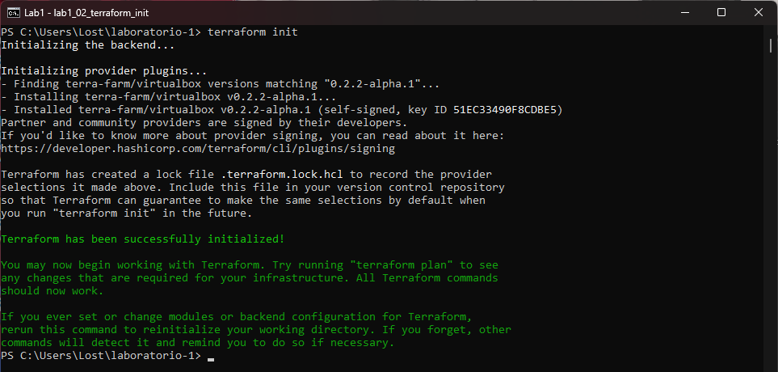

`terraform plan`, que la guía marca como paso obligatorio:

```text
Plan: 1 to add, 0 to change, 0 to destroy.

Changes to Outputs:
  + vm_name = "vm-sistemas-operativos"
```

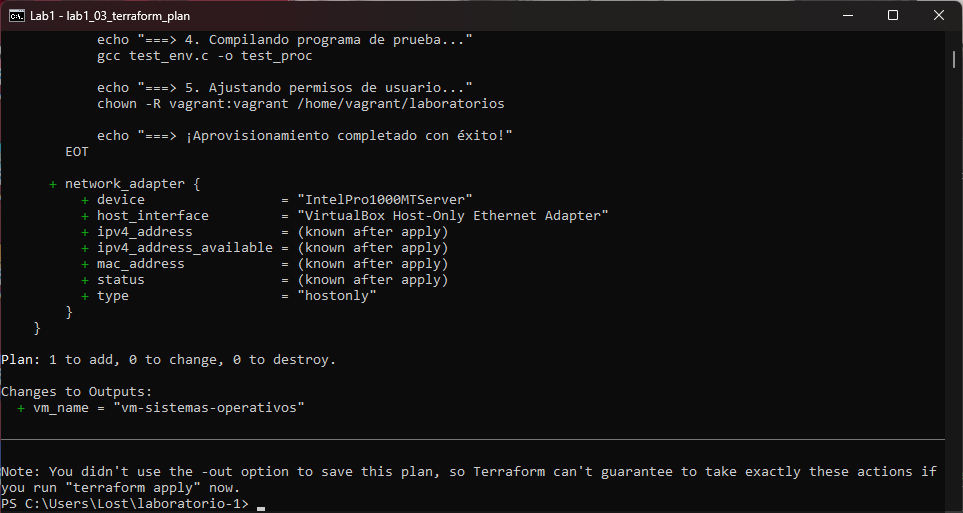

`terraform apply -auto-approve` sí creó y arrancó la máquina, pero se quedó esperando un minuto y medio
y terminó en error:

```text
virtualbox_vm.so_node: Creating...
virtualbox_vm.so_node: Still creating... [01m20s elapsed]

Error: [ERROR] Wait VM until ready: waiting for VM (vm-sistemas-operativos) to become ready:
[ERROR] can't convert vbox network to terraform data: No match with get guestproperty output
```

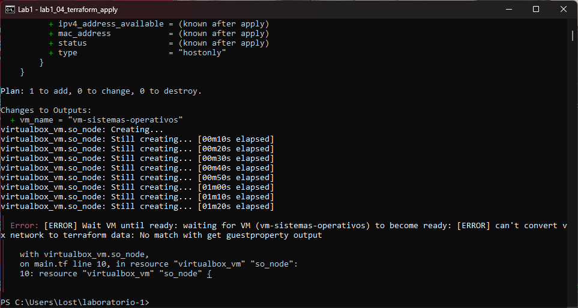

**Qué pasó.** El proveedor arranca la VM y después le pregunta a VirtualBox cuál es la IP del huésped,
para rellenar el campo `ipv4_address` que en el plan quedaba como `(known after apply)`. Esa consulta
la responde el servicio de las Guest Additions desde adentro de la máquina, y en esta imagen no está
corriendo:

```text
C:\> VBoxManage showvminfo "vm-sistemas-operativos" --machinereadable | findstr GuestAdditions
GuestAdditionsRunLevel=0
```

Nivel 0 es servicio detenido. Mirando la pantalla de la VM se ve que el arranque nunca llega al login:

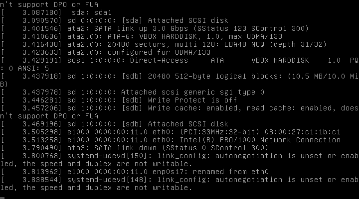

Son dos cosas juntas. Las Guest Additions de esa imagen son de la época de VirtualBox 6.x y no cargan
en 7.2, y además el `main.tf` le pone a la VM un único adaptador `hostonly`, sin NAT, así que la
máquina tampoco habría tenido salida a internet para el `apt-get update` del aprovisionamiento. El
proveedor `terra-farm/virtualbox` sigue en versión alpha y no se actualizó para VirtualBox 7.

Borré la máquina que quedó a medias y pasé a la opción B, que la guía ofrece como alternativa válida:

```text
C:\> VBoxManage controlvm "vm-sistemas-operativos" poweroff
C:\> VBoxManage unregistervm "vm-sistemas-operativos" --delete
```

### 1.2 Opción B con Vagrant

```text
PS C:\Users\Lost\laboratorio-1> vagrant up
...
    default: ===> 2. Creando estructura de directorios del curso...
    default: ===> 3. Creando programa de prueba de entorno (test_env.c)...
    default: ===> 4. Compilando programa de prueba...
    default: ===> 5. Ajustando permisos de usuario...
    default: ===> ¡Aprovisionamiento completado con éxito!
```

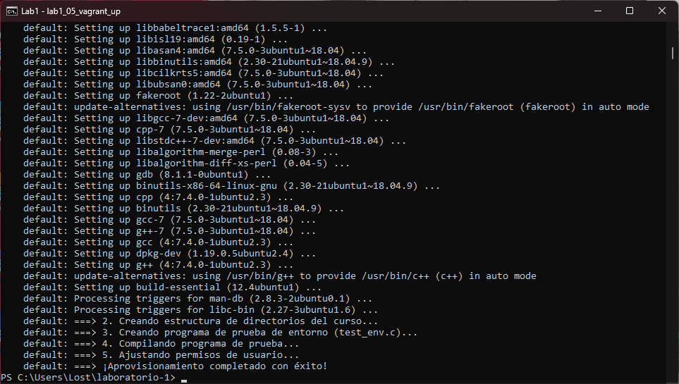

```text
PS C:\Users\Lost\laboratorio-1> vagrant status
Current machine states:

default                   running (virtualbox)
```

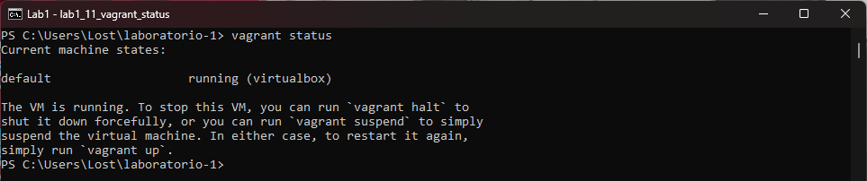

---

## Parte 2: Acceso a la máquina virtual

```text
PS C:\Users\Lost\laboratorio-1> vagrant ssh
vagrant@so-environment:~$ hostname
so-environment
vagrant@so-environment:~$ whoami
vagrant
vagrant@so-environment:~$ uname -a
Linux so-environment 4.15.0-212-generic #223-Ubuntu SMP Tue May 23 13:09:22 UTC 2023 x86_64 x86_64 x86_64 GNU/Linux
```

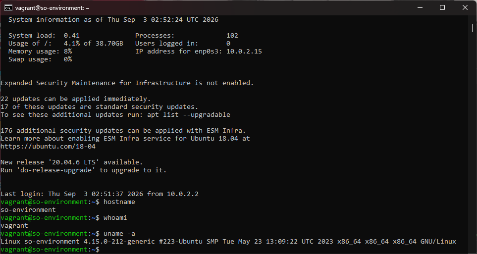

La conexión no va a ninguna IP de la VM: Vagrant redirige el puerto 2222 del anfitrión al 22 del
huésped y autentica con una llave privada que guarda en la carpeta `.vagrant` del laboratorio.

```text
PS C:\Users\Lost\laboratorio-1> vagrant ssh-config
Host default
  HostName 127.0.0.1
  User vagrant
  Port 2222
  PasswordAuthentication no
  IdentityFile C:/Users/Lost/laboratorio-1/.vagrant/machines/default/virtualbox/private_key
```

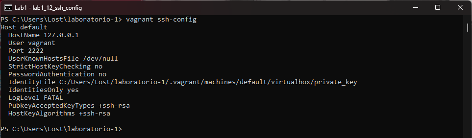

---

## Parte 3: Verificación de Herramientas Instaladas

```text
vagrant@so-environment:~/laboratorios/unidad1$ gcc --version
gcc (Ubuntu 7.5.0-3ubuntu1~18.04) 7.5.0

vagrant@so-environment:~/laboratorios/unidad1$ make --version
GNU Make 4.1
Built for x86_64-pc-linux-gnu

vagrant@so-environment:~/laboratorios/unidad1$ strace -V
strace -- version UNKNOWN
Copyright (c) 1991-2018 The strace developers <https://strace.io>.

vagrant@so-environment:~/laboratorios/unidad1$ htop --version
htop 2.1.0 - (C) 2004-2018 Hisham Muhammad

vagrant@so-environment:~/laboratorios/unidad1$ which gcc make strace htop
/usr/bin/gcc
/usr/bin/make
/usr/bin/strace
/usr/bin/htop
```

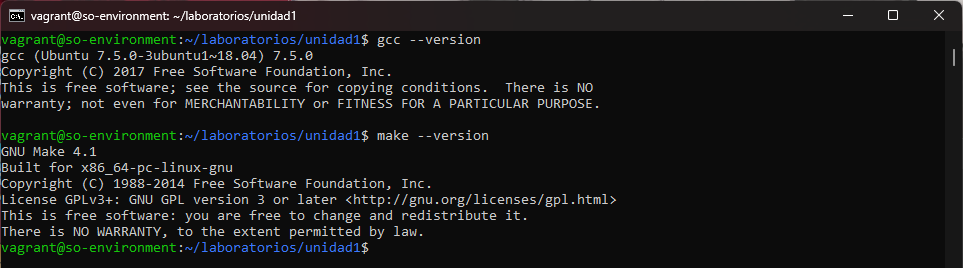

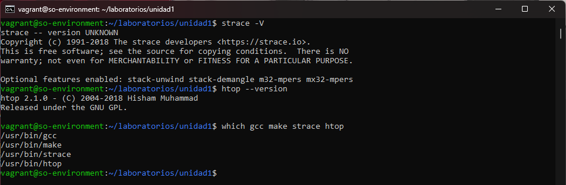

| Herramienta | Comando | Versión | Ruta |
| ----------- | ------- | ------- | ---- |
| gcc | `gcc --version` | 7.5.0 | /usr/bin/gcc |
| make | `make --version` | GNU Make 4.1 | /usr/bin/make |
| strace | `strace -V` | cadena `UNKNOWN` | /usr/bin/strace |
| htop | `htop --version` | 2.1.0 | /usr/bin/htop |

La versión de strace sale como `UNKNOWN`: es un detalle conocido del empaquetado de Ubuntu 18.04, el
binario funciona igual pero no trae la cadena de versión compilada dentro. Para comprobar que htop no
solo está instalado sino que sirve, lo abrí:

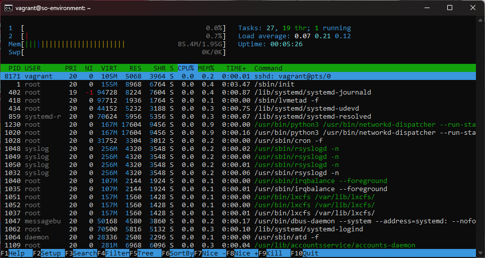

---

## Parte 4: Prueba de Ejecución Básica

```text
vagrant@so-environment:~$ cd ~/laboratorios/unidad1
vagrant@so-environment:~/laboratorios/unidad1$ pwd
/home/vagrant/laboratorios/unidad1
vagrant@so-environment:~/laboratorios/unidad1$ ls -l
total 16
-rw-r--r-- 1 vagrant vagrant  316 Sep  3 02:51 test_env.c
-rwxr-xr-x 1 vagrant vagrant 8392 Sep  3 02:51 test_proc
vagrant@so-environment:~/laboratorios/unidad1$ ./test_proc
=========================================
 ¡ENTORNO DE SISTEMAS OPERATIVOS LISTO!
 PID del proceso: 8084
=========================================
```

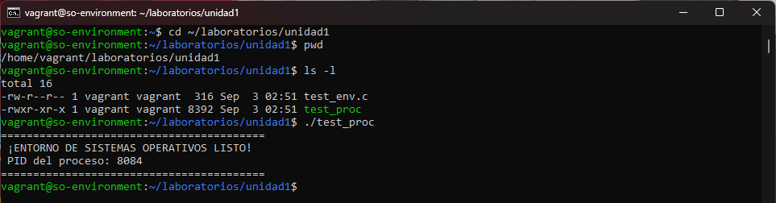

El PID cambia en cada ejecución porque el kernel le asigna un identificador nuevo a cada proceso que
nace; el programa lo consulta con `getpid()`.

---

## Estado final de la máquina virtual

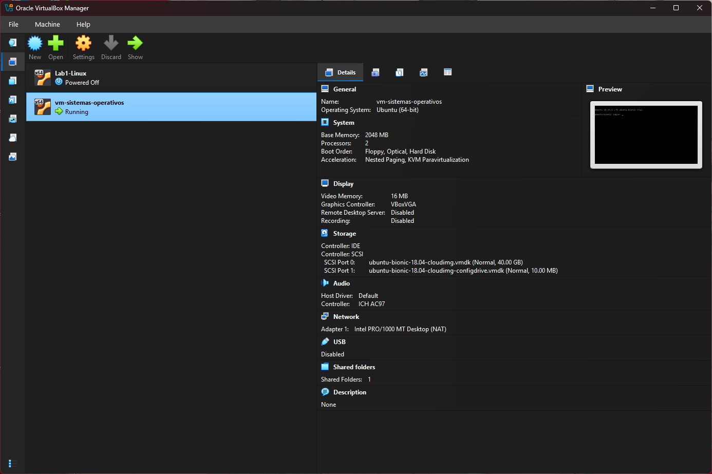

```text
vagrant@so-environment:~$ nproc
2
vagrant@so-environment:~$ free -h | head -2
              total        used        free      shared  buff/cache   available
Mem:           1.9G         83M        1.0G        592K        853M        1.7G
vagrant@so-environment:~$ df -h / | tail -1
/dev/sda1        39G  1.6G   38G   5% /
vagrant@so-environment:~$ lsb_release -d
Description:	Ubuntu 18.04.6 LTS
```

---

## Lista de comprobación

| Elemento | Comando | Verificado |
| ----------------- | -------------------------------- | :--------: |
| Máquina virtual | `vagrant up` | ☑ |
| Plan de ejecución | `terraform plan` | ☑ |
| Acceso a la VM | `vagrant ssh` | ☑ |
| GCC | `gcc --version` | ☑ |
| Make | `make --version` | ☑ |
| Strace | `strace -V` | ☑ |
| Htop | `htop --version` | ☑ |
| Programa de prueba | `./test_proc` | ☑ |

---

## Conclusiones

1. El entorno quedó listo: la VM arranca, se entra por SSH sin contraseña, las cuatro herramientas
   están instaladas y `test_proc` compila y corre. Se puede usar en los laboratorios que vienen.

2. Lo que más me llevo es el intento fallido. Terraform y Vagrant describen la misma máquina casi con
   las mismas palabras (dos CPU, 2 GB, Ubuntu Bionic) y sin embargo uno funciona y el otro no. La
   diferencia está en algo que ninguno de los dos archivos menciona: Terraform necesita que el huésped
   le conteste desde adentro a través de las Guest Additions, y Vagrant no. Un supuesto invisible sobre
   el software que corre dentro de la máquina bastó para tumbar el despliegue completo.

3. Instalar Vagrant y Terraform con `winget` fue lo más rápido del laboratorio. Lo que costó tiempo fue
   entender el error del proveedor, y para eso hizo falta salirse de la herramienta y preguntarle
   directo a VirtualBox con `VBoxManage showvminfo` y `VBoxManage guestproperty enumerate`. Cuando la
   capa de abstracción falla, hay que saber mirar debajo.

4. `vagrant ssh-config` me mostró que la conexión va a `127.0.0.1:2222` y no a ninguna IP de la máquina
   virtual. Le venía diciendo "conectarme a la VM" a algo que en realidad es una redirección de puertos
   del anfitrión hacia el huésped.
