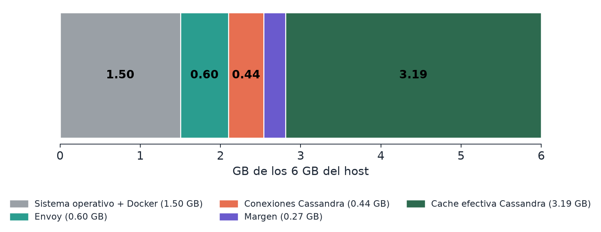
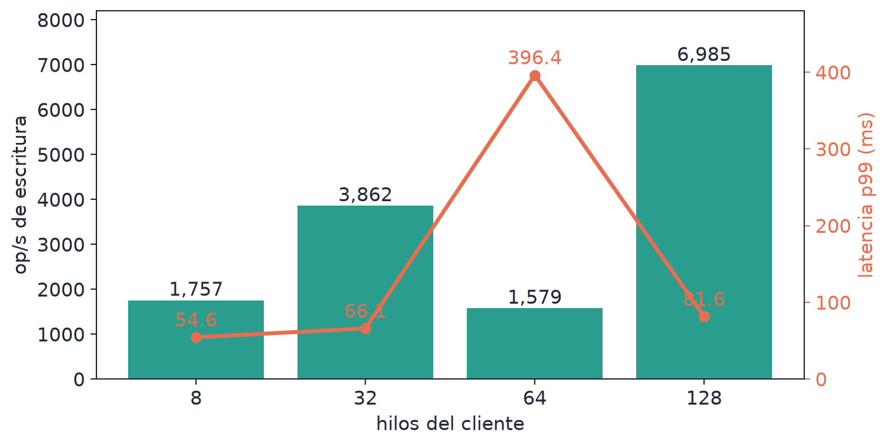

# Project 1: Envoy and Cassandra 5 on 6 GB and 3 vCPU

  

Group 2's work, case study 6: an IoT telemetry platform taking 50 000 writes per second from 10 000 concurrent devices, with Envoy at the front and Cassandra 5 behind it. The task was to size the host and deploy it with Docker, then prove live that the table matches what the operating system actually enforces.

## Sizing

The Docker route costs 25 % of RAM for the host (1.5 GB), which leaves 4.5 GB.

| | Envoy | Cassandra |
| --- | --- | --- |
| `mem_limit` | 614 MiB | 3 993 MiB |
| vCPU | 0.75 | 2.25 |
| Notes | 1 worker (`--concurrency 1`), cap of 150 upstream connections | 2 GiB heap, 768 MiB off-heap memtables, 384 MiB file cache |

Little's law gives 50 000 writes/s times 0.2 s, which is 10 000 simultaneous connections, so one event loop carries all of them. After the 150 connections (450 MB) and a 275 MB margin, Cassandra is left with 3.19 GB. `memswap_limit` equals `mem_limit`, so an overflow ends in the OOM killer of the cgroup and not in swap.

<picture>
  <source media="(prefers-color-scheme: dark)" srcset="figures/fig_memoria_dark.png">
  
</picture>

## What the live demo showed

- `docker inspect` and cgroup v2 (`memory.max`, `memory.swap.max` at 0, `cpu.max` at 75 000 and 224 999 µs per 100 000) agree with the table. So do `cassandra.yaml` and the JVM flags.
- Even so, a stress test in four 40 s stages of 8, 32, 64 and 128 threads never saturated a hard limit. Cassandra peaked at 2.55 GiB of 3.90, Envoy at 13.5 MiB of 614, there was no `OOMKilled` and swap stayed at zero.
- Throughput topped out at 6 985 op/s, 14 % of the 50 000 target. The 64-thread stage dipped to 1 579 op/s and we could not isolate why. The VM runs on Hyper-V emulation and the load client shares the three vCPUs, so the report leaves it unattributed. The memory and CPU sizing is consistent, but the 50 000 op/s capacity was not verified here.
- The connection cap is real. Of 200 TCP connections to port 9042, `upstream_cx_active` stopped at 150 and the other 50 went to `upstream_cx_overflow`.
- A throwaway 64 MB container that tried to allocate 300 MB was killed inside its cgroup (exit 137, `OOMKilled=true`) while Envoy and Cassandra kept running.

<picture>
  <source media="(prefers-color-scheme: dark)" srcset="figures/fig_estres_dark.png">
  
</picture>

## Files

- [`report.pdf`](report.pdf): technical report with the resource table and justification (Spanish)
- [`demo.mp4`](demo.mp4): recording of the live demo
- [`src/`](src): `docker-compose.yml`, `Dockerfile`, `envoy.yaml` and the monitoring, stress and demo scripts
- [`figures/`](figures) and [`screenshots/`](screenshots): charts and terminal evidence
